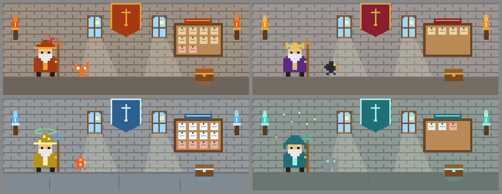

# The Guild Hall

A Claude mod that turns your Claude session into a 16-bit fantasy adventurers' guild: your Jira tickets are quests, review requests are bounties, merged PRs and resolved tickets earn XP, loot and achievements.




## What it does

- **Guild Hall pane** beside the chat. An animated pixel-art hall that follows your Claude app's light or dark mode, or the real clock (dawn, day, dusk, night), with your hero, a familiar, a quest board that fills with one note per open ticket, a loot chest, and seasonal touches (snow and garlands in winter, pumpkins in October).
- **Sweep the realm** (`/sweep`, the Sweep button, or every 30 minutes):
  - **Quests:** Jira tickets assigned to you, ranked; blocked tickets are cursed, untouched ones gather cobwebs.
  - **Bounties:** pull requests waiting on your review, red once someone has waited 2+ days.
  - **The forge:** your open PRs with checks and review state.
  - **Alerts:** new review requests, approvals, changes requested, CI failures, newly assigned tickets, and reviews that have waited 2+ days.
- **Rewards for outcomes, not busywork:** resolved tickets, merged PRs and reviews pay XP and gold. Reviews pay more when the author waited over a day, and getting a blocked ticket moving pays a bonus. Tool calls and turns are capped at 40 XP a day.
- **Weekly boss:** a new boss every Monday, sized to your open work. Everything you finish deals damage; defeat it for a guaranteed epic or legendary relic.
- **Daily contracts:** three small goals each day aimed at neglected work (review a PR that has waited, lift a curse, dust off a cobwebbed ticket). Finish all three to open a chest.
- **Forgiving streaks:** weekends never break a streak, shields (earned every 5 days, hold 2) cover a missed day, and a miss halves the streak instead of zeroing it. A lifetime day count never resets.
- **A familiar that reacts:** cheers on merges, panics when CI fails, naps when you step away. It never needs feeding.
- **Market:** spend gold on real-world rewards you define yourself.
- **Chronicle:** this week's deeds and a ready-to-paste weekly update for Slack, with a Friday reminder.
- **Focus:** `/focus 25` lights a candle that burns down in the hall; finishing pays XP. Stopping early has no penalty.
- **Unlocks at every level** from 2 to 20, 22 relics, 21 achievements.
- **Calm mode:** hides numbers, toasts, sounds and effects for heads-down days.

## Install

At the prompt of a Claude Code terminal session:

```
/plugin install guild-hall --marketplace KauJha/guild-hall
```

From a shell:

```
claude plugin install guild-hall --marketplace KauJha/guild-hall
```

In the Claude desktop app: click **+** next to the prompt box, then **Plugins**, **Add marketplace** with `KauJha/guild-hall`, then **Add plugin**.

To update an installed copy: `claude plugin update guild-hall`, then `/reload-plugins` in your session. Progress is kept.

## What a sweep needs

- **Jira:** an Atlassian connector connected in Claude. The mod finds it on its own.
- **GitHub:** the [GitHub CLI](https://cli.github.com) installed and signed in (`gh auth login`).

Either one alone works; the other section shows how to connect it.

## Use

- `/guild` opens the Guild Hall. `/sweep` refreshes quests and bounties. `/focus 25` starts a focus session; `/focus stop` ends it.
- **Armory:** rename your hero, pick a hall theme, hat, robe, familiar and aura, choose the time of day, and switch calm mode, auto-sweep and sound.
- **Treasury:** relics found and achievements.

## XP

| Deed | XP |
| --- | --- |
| Jira ticket resolved | 35 to 200 by type (bug 80, story 90, epic 200) |
| Blocked ticket moving again | 40 |
| Your PR merged | 60 |
| A review you gave | 35, or 60 if the author waited over a day |
| Daily contract | 30 each, plus a chest for all three |
| Weekly boss defeated | 300 and a guaranteed epic or legendary relic |
| Focus session | 15 per 25 minutes |
| Claude task completed (side quest) | 20 |
| Answered turns and tool calls | 3 / 1, capped at 40 a day together |
| Daily boon | 20 × streak days (up to 5) |

Level *n* takes `100 × n^1.5` XP.

## Privacy

The mod holds no keys or tokens. A sweep reads Jira through your own Atlassian connector and GitHub through your own `gh` login, on your machine. What it keeps (your hero, your board's last snapshot, which tickets and PRs were already credited, relics) stays in the plugin's local store on your machine.

## License

MIT
