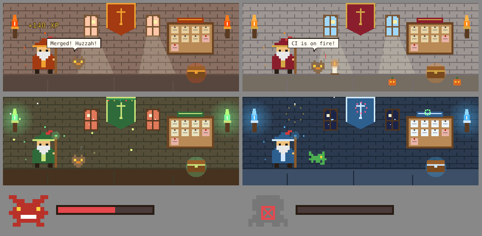

# The Guild Hall

A Claude mod that turns your Claude session into a 16-bit fantasy adventurers' guild: your Jira tickets are quests, review requests are bounties, merged PRs and resolved tickets earn XP, loot and achievements.




## What it does

- **Guild Hall pane** beside the chat. An animated pixel-art hall that follows your Claude app's light or dark mode (a sunlit hall by day, torch-lit at night), with your hero, familiar, a quest board that fills with one note per open ticket, and a treasure chest that glows when you've found loot.
- **Sweep the realm.** `/sweep`, the Sweep button, or automatically every 30 minutes:
  - **Quests:** Jira tickets assigned to you, ranked (bugs are monster hunts, stories are sagas, blocked tickets are cursed, untouched ones gather cobwebs).
  - **Bounties:** pull requests waiting on your review.
  - **The forge:** your open PRs with their checks and review state.
  - Tickets you resolve, PRs of yours that merge and reviews you give earn XP on the next sweep. The first sweep records what's already done, so old work is never paid twice.
- **Rewards:** something unlocks at every level from 2 to 20 (themes, hats, robes, seven familiars, auras, titles), 22 relics to collect from loot drops, 16 achievements, and a daily streak boon.
- **Spellbook:** every tool Claude runs is a spell (`Read` is *Scry Scroll*, `Bash` is *Golem's Command*).
- **Side quests:** Claude's own task lists, shown alongside your real quests.
- **Status band** above the prompt: level, XP, streak, quests, bounties.

## Install

At the prompt of a Claude Code terminal session:

```
/plugin install guild-hall --marketplace KauJha/guild-hall
```

From a shell:

```
claude plugin install guild-hall --marketplace KauJha/guild-hall
```

In the Claude desktop app: click **+** next to the prompt box, then **Plugins**, **Add marketplace** with `KauJha/guild-hall`, then **Add plugin**.

To update an installed copy: `claude plugin update guild-hall`, then `/reload-plugins` in your session. Progress is kept.

## What a sweep needs

- **Jira:** an Atlassian connector connected in Claude. The mod finds it on its own.
- **GitHub:** the [GitHub CLI](https://cli.github.com) installed and signed in (`gh auth login`).

Either one alone works; the other section shows how to connect it.

## Use

- `/guild` opens the Guild Hall. `/sweep` refreshes quests and bounties.
- **Armory:** rename your hero, pick a hall theme, hat, robe, familiar and aura, choose day/night or "match the app", and turn auto-sweep and sound on or off.
- **Treasury:** relics found and achievements.

## XP

| Deed | XP |
| --- | --- |
| Jira ticket resolved | 35 to 200 by type (bug 80, story 90, epic 200) |
| Your PR merged | 60 |
| A review you gave | 35 |
| Claude task completed (side quest) | 20 |
| Answered turn / successful tool call | 3 / 1 |
| Daily boon | 25 × streak days (up to 7) |

Level *n* takes `100 × n^1.5` XP.

## Privacy

The mod holds no keys or tokens. A sweep reads Jira through your own Atlassian connector and GitHub through your own `gh` login, on your machine. What it keeps (your hero, your board's last snapshot, which tickets and PRs were already credited, relics) stays in the plugin's local store on your machine.

## License

MIT
