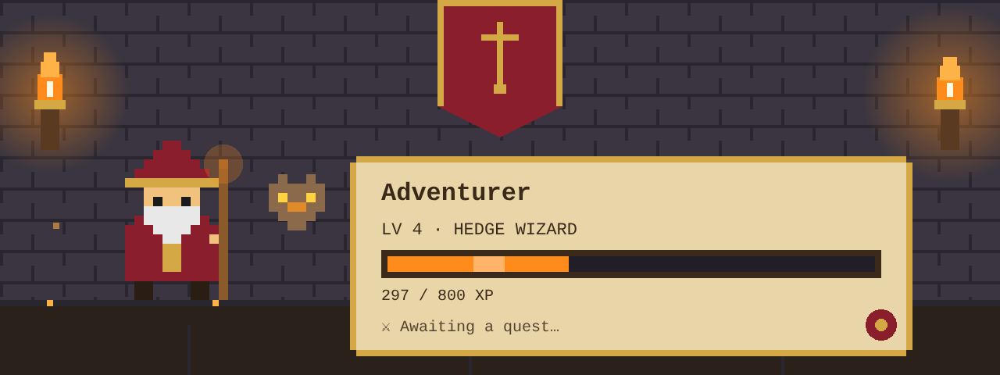
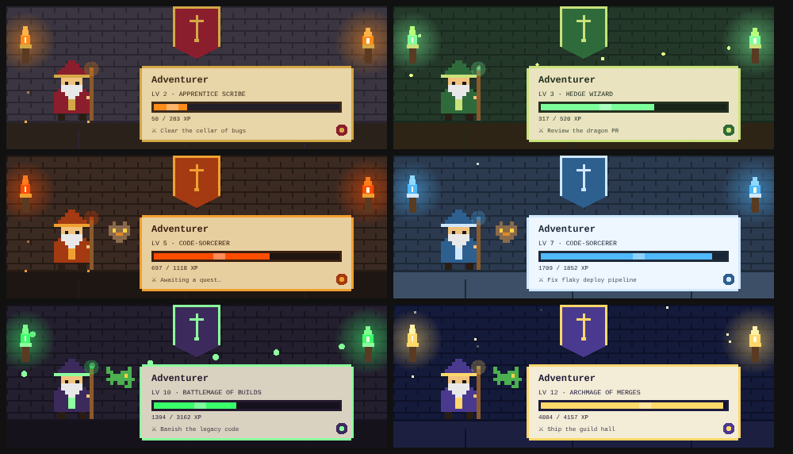

# The Guild Hall

A Claude mod that turns your Claude session into a 16-bit fantasy adventurers' guild.



## What it does

- **Guild Hall pane** beside the chat: an animated pixel-art hall (flickering torches, a guild banner, your wizard and familiar) with your name, level, title and XP bar.
- **Quest Board:** Claude's own task list shows up as quests: posted, active, cleared.
- **Spellbook:** every tool Claude runs is cast as a spell (`Read` is *Scry Scroll*, `Bash` is *Golem's Command*, a web search is *Consult the Oracle*, and so on).
- **XP and levels:** earned from real work: successful tool calls, answered turns and cleared quests. Level-ups play a chiptune fanfare and show a toast.
- **Armory:** six themes unlock as you level (Stone Guild Hall, Elven Grove, Dwarven Forge, Frost Citadel, Necromancer's Crypt, Celestial Observatory), plus an owl and a dragon whelp familiar.
- **Status band** above the prompt with your level, XP and current quest.
- **Narrator (optional, off by default):** lets Claude open replies with one short guild-master line. Code, commands and anything technical stay plain.



## Install

At the prompt of a Claude Code terminal session:

```
/plugin install guild-hall --marketplace KauJha/guild-hall
```

From a shell:

```
claude plugin install guild-hall --marketplace KauJha/guild-hall
```

In the Claude desktop app: click **+** next to the prompt box, then **Plugins**, **Add marketplace** with `KauJha/guild-hall`, then **Add plugin**.

Answer `y` to add the marketplace, then pick a scope.

## Use

- `/guild` opens the Guild Hall pane (and brings back the band if you hid it).
- **Armory** in the pane: rename your hero, equip unlocked themes.
- **Narrator** and **Sound** toggles are in the pane.

## XP rules

| Deed | XP |
| --- | --- |
| A tool call that succeeds | 1 |
| An answered turn | 3 |
| A quest posted (Claude creates a task) | 2 |
| A quest cleared (a task is completed) | 20 |

Level *n* takes `100 × n^1.5` XP.

## Privacy

The mod has no network access of its own, calls no connectors or MCP servers, and holds no keys or tokens. It only watches events inside your own Claude session (tool names, task titles) and keeps your hero (name, XP, counters, settings) in the plugin's local store on your machine. Task titles are kept for the current session only.

## License

MIT
